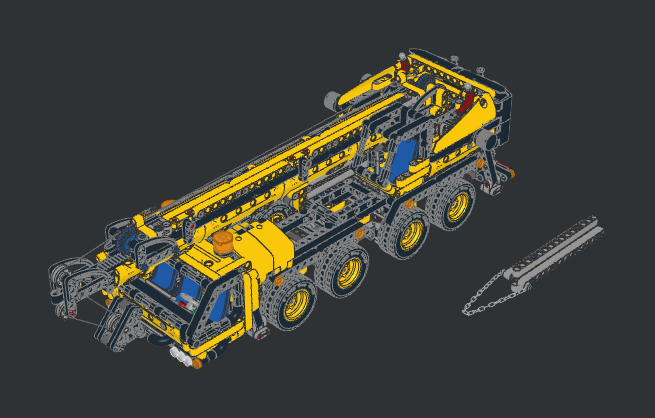

# LEGO Technic 42108 Mobile Crane

This static LDraw MPD is an adaptation of Max Martin Richter's [42108-1 model in the LDraw Official Model Repository](https://library.ldraw.org/omr/sets/1113). The crane, hoist cord, and separate chain-and-beam load are present; stickers are not. Open it with LeoCAD or another LDraw application using the [current parts library](https://library.ldraw.org/updates).



- [Model MPD](LEGO-42108-Mobile-Crane.mpd)
- [CAD review and limitations](LEGO-42108-CAD-Review.md)
- [Part and color comparison CSV](LEGO-42108-Inventory-Check.csv)
- [Machine-readable check summary](review-summary.json)
- [Structure, palette, and mechanism notes](design-notes.md)

## Repeat the checks

The LeoCAD viewer is not bundled. The [CAD review](LEGO-42108-CAD-Review.md#reproduce-the-review) lists the Nova revision, LeoCAD version, and both review commands. The standard check and the `--contacts all` check make different claims; run both if reviewing fit.

To repeat inventory reconciliation with Python 3.10+ from this directory:

```sh
python tools/compare-crane-bom.py LEGO-42108-Mobile-Crane.mpd \
  /path/to/ldraw data/inventory-reference.csv data/ldraw-colors.json \
  /tmp/42108-inventory-check.csv
```

`data/` contains only the publication-safe lookup fields needed to repeat the check offline. The inventory uses [Rebrickable's 42108-1 v3 records](https://rebrickable.com/api/v3/lego/sets/42108-1/parts/); color lookups are from the [Rebrickable color endpoint](https://rebrickable.com/api/v3/lego/colors/).

To regenerate the adaptation, download `42108-1.mpd` from the [OMR source page](https://library.ldraw.org/omr/sets/1113). The script uses NumPy and the official LDraw library, so results can vary if library aliases change:

```sh
python tools/normalize-crane-mpd.py /path/to/42108-1.mpd \
  /path/to/ldraw /tmp/42108-reviewed.mpd /tmp/42108-changes.json
```

The source CC BY 2.0 terms and attributions are preserved in the MPD. Refer to the review for a list of modifications and the verified MPD checksum.

Reproduction inputs used for the published review:

- OMR MPD SHA-256: `b06471bb85949945a50ed3ae54a8137ef81dcaddc5bf307c619e60f24f6f080a`
- Official LDraw `complete.zip` SHA-256: `023083918da2d3697c794fb4267975509584f3611b993095874206a803fa610f`
